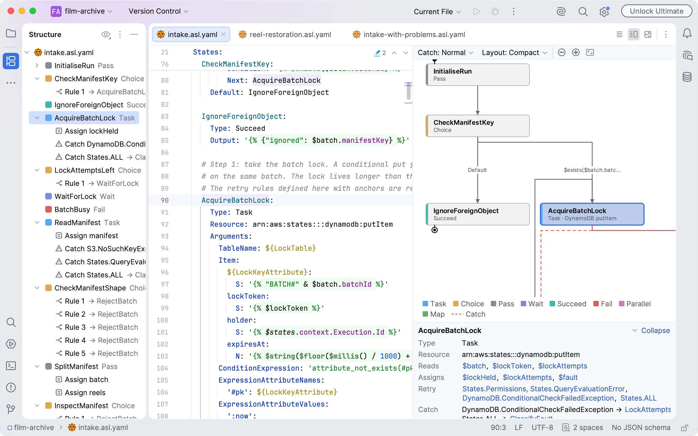
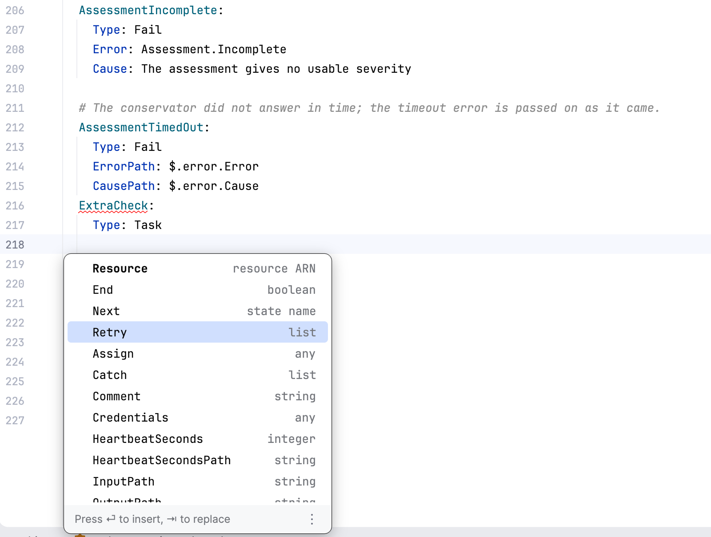
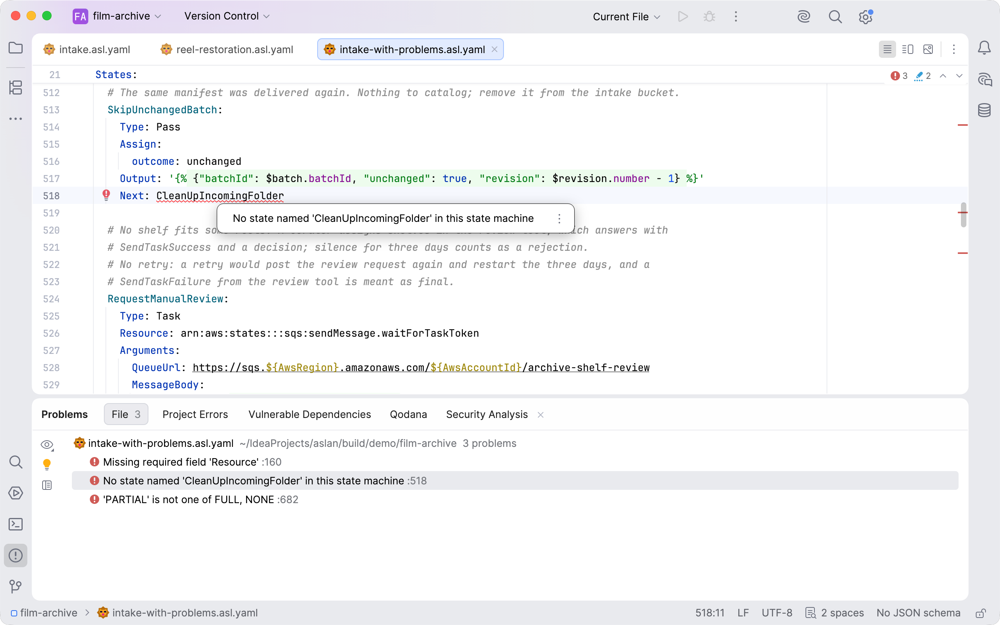
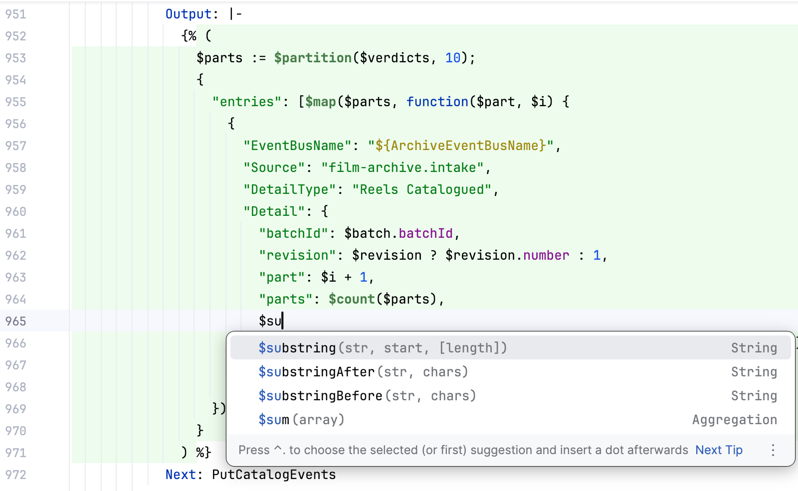
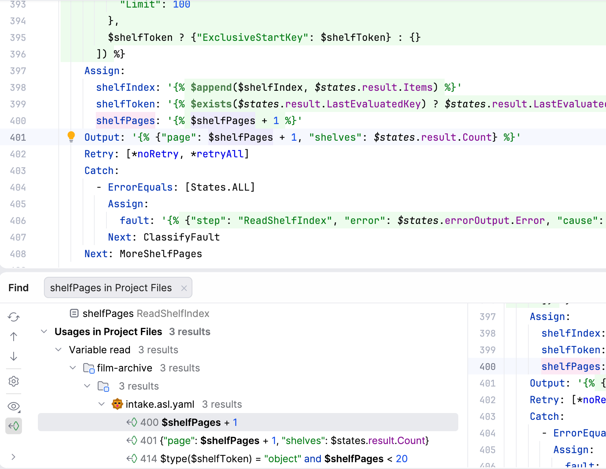
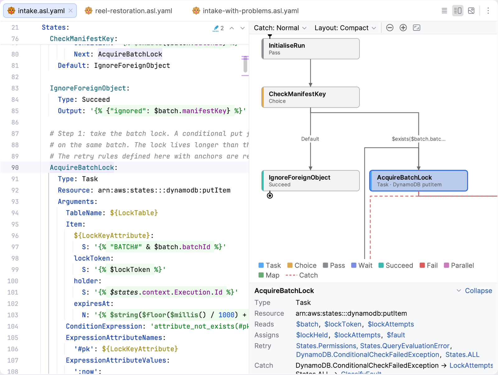

# Aslan

Aslan is a plugin for JetBrains IDEs that gives editor support for AWS Step Functions state machine definitions (Amazon States Language) in YAML and JSON, for people who write and maintain these definitions as files.

[](https://github.com/saigyo/aslan/actions/workflows/build.yml)



## What it does

- **The editor understands Amazon States Language.** It completes field names, state types, fixed values and state names, checks the definition the way AWS does at deployment, shows documentation for fields and values, and lets you go to, find and rename states.
- **JSONata expressions behave like code.** The expressions inside `` strings are highlighted, checked for syntax as Step Functions parses them, and have completion, documentation and local variables you can rename.
- **State machine variables can be followed.** With the caret on a variable, its assignments and reads are highlighted in two colours, and you can step through them, go to an assignment, find all usages and rename the variable.
- **A live diagram sits beside the editor.** It shows the states and paths of the machine, follows the caret, and moves the caret to a state or path you click.

## Installation

From the JetBrains Marketplace, once the plugin is published there: open Settings | Plugins, search for "Aslan" on the Marketplace tab and install it.

From a zip built locally: run `./gradlew buildPlugin`, which writes `build/distributions/aslan-1.0.0.zip`. In Settings | Plugins, choose Install Plugin from Disk in the gear menu and select the zip.

## Getting started

1. Name the definition `*.asl.yaml`, `*.asl.yml` or `*.asl.json`, or add your own pattern under Settings | Languages & Frameworks | Amazon States Language.
2. Open the file. The editor is on the left and the diagram on the right; the buttons at the top right of the editor switch between editor, both, and diagram.
3. Click a state in the diagram or in the Structure tool window to go to it. Place the caret on a variable to see where it is assigned and read.
4. The checks are listed under Settings | Editor | Inspections | Amazon States Language; each can be switched off.

## Using the plugin

Shortcuts below are those of the default keymaps, first for macOS and then for Windows. Settings | Keymap shows them for the keymap you use.

### Writing a definition



- **Completion** (Ctrl+Space) offers the field names that fit the structure at the caret, taking the state type and the query language into account and leaving out fields already present. It also offers state types, fixed values such as comparison operators, `JitterStrategy` or `Mode`, the predefined error names under `ErrorEquals`, and state names in `StartAt`, `Next` and `Default`. Choosing a state type in a new YAML state also inserts the fields that type needs.
- **Quick documentation** (F1 / Ctrl+Q, or hover) explains field names, state types and fixed values in the plugin's own words, with a link to the AWS documentation page.
- **The Structure tool window** (Cmd+7 / Alt+7) lists the states in file order with an icon for each type. The states of a Map or Parallel state are nested below it, and below each state are its assignments, Choice rules and Catchers. It works for YAML and JSON.
- **State names:** Go to Declaration (Cmd+B / Ctrl+B) on a transition goes to the state it names, Find Usages (Option+F7 / Alt+F7) lists the transitions that name a state, and Rename (Shift+F6) renames a state together with all of them. A rename stays inside its own state machine, and the plugin reports name conflicts.
- **Highlighting** sets ASL field names apart from keys inside free-form data such as `Arguments`, and marks state names and transition targets.

ASL files have their own icon in the editor tabs and the Project tool window.

### Checks



The checks report missing, unknown or misplaced fields, values of the wrong kind or outside their range, Task resources and roles that AWS rejects, transitions to states that do not exist, states that nothing leads to, duplicate state names, malformed paths and timestamps, and similar problems. The findings are underlined in the editor and listed in the Problems tool window.

The rule is: a problem is an error only where AWS rejects the definition at deployment, and everything that deploys is at most a warning. The checks were compared with the definition validation of AWS Step Functions; the [design document](docs/superpowers/specs/2026-11-13-aslan-design.md) describes how.

Every check has its own entry under Settings | Editor | Inspections | Amazon States Language, where it can be switched off or given another severity.

Placeholders such as `${name}`, YAML anchors, aliases and merge keys, and the contents of free-form data fields such as `Arguments`, `Parameters` or `Result` are never reported.

### JSONata



JSONata is recognised in `` strings where Step Functions evaluates it: in states that use JSONata, in YAML (quoted, literal and folded scalars) and in JSON.

- **Highlighting** with its own colour settings, and a syntax check exactly as Step Functions parses expressions (JSONata 2.0.6, including its rules for where a `/` starts a regular expression).
- **Six inspections**, each of which can be switched off: a syntax error; a field of `$states` that does not exist where it is used (for example `$states.result` outside a Task, Map or Parallel state); an operator of JSONata 2.1 (`?:`, `??`), which Step Functions does not have; a field name, `$` or `$$` where there is no input; a call of an unknown function; and `$eval`, which Step Functions does not support.
- **Completion** of the built-in functions and the Step Functions additions, of `$states` and its fields (including the fields of `$states.context`), of local variables and of keywords. Quick documentation and parameter hints (Cmd+P / Ctrl+P) for functions.
- **Local variables** (`$x := …` and function parameters): go to declaration, find usages, usage highlighting and rename, within the expression.
- Matching of brackets and quotes, and comment toggling. Typing the quote of the surrounding YAML or JSON string inside an expression inserts its escaped form, so the string stays intact.

### State machine variables



Each key of an `Assign` is an assignment, and each `$name` that is no local variable, built-in function or `$states` is a read of the variable of the same scope. This works in YAML and JSON, in JSONata and JSONPath states. Two Parallel branches that assign the same name have two variables.

- **Usage highlighting:** with the caret on a variable, its assignments and reads are highlighted in different colours, in the YAML or JSON key and inside expressions.
- **Stepping through usages:** Next Highlighted Usage and Previous Highlighted Usage (Ctrl+Option+Down and Ctrl+Option+Up in the default macOS keymap; the default Windows and Linux keymaps bind none, so assign one under Settings | Keymap or call the action by name). With the caret inside an expression, the shortcut runs the plugin's own Next Highlighted Usage in State Machine and Previous Highlighted Usage in State Machine, which step through the whole file; the menu entry Edit | Find Usages | Next Highlighted Usage is the platform's and stays inside the expression.
- **Go to Declaration** from a read lists the assignments, with the state and place of each.
- **Find Usages** lists the reads and shows the assignments as the variable's declarations.
- **Rename** changes keys and expressions together. It refuses, and names the place, when it cannot be sure to keep the meaning of every occurrence: for example when the new name is already used where the variable is visible, or when the definition does not show every name it assigns.
- **Completion** after `$` in JSONata offers the variables visible there.

Seven inspections check variables: a read of a variable nothing assigns (an error in a JSONPath string and in a Distributed Map, as AWS rejects it; a warning in JSONata elsewhere, where AWS only warns); an `Assign` key AWS rejects as a name (an error) or that is no plain name (a warning); an assignment in a Map or Parallel state of a name that an outer state machine assigns before (an error, as AWS rejects it); and a variable that is assigned but never read (a weak warning). Where a definition does not say every name it assigns, for example through a placeholder in `Assign`, nothing that depends on the missing names is reported.

### Diagram



An ASL file opens in a split editor, with the text on the left and the diagram on the right. The three buttons at the top right of the editor choose Editor, Editor and Preview, and Preview. The mode is remembered for each file.

- **States** are boxes with the state's name and, on a second line, its type and for a Task a short form of its resource (for example "Task · DynamoDB putItem"). A bar at the left edge has the type's colour; the legend below the diagram names the colours. The start state has a mark above it, a terminal state a mark below it.
- **Map and Parallel states** are boxes around their inner states, a Parallel state with one box for each branch. The "−" and "+" control collapses and expands such a box while the file is open.
- **Paths** run top to bottom with right-angle bends. A Choice path is labelled with its condition and the default path with "Default"; a rule that does not fit on one line is labelled "Rule n". Long labels and names are cut; hovering a cut label or a "Rule n" label shows the whole condition, and hovering a cut name shows the whole name. Catch paths are dashed and red and labelled "Catch"; hovering one shows its error names.
- **Catch: Normal, Muted, Hidden** in the toolbar draws catch paths normally, faint, or not at all. No state moves when you change it.
- **Layout: Loose, Compact.** The loose layout gives every path its own line and room for longer labels; the compact layout places states closer and lets paths into one state share a line. A machine with at most 25 states, nested ones included, opens in the loose layout, a larger one in the compact layout. A layout you choose is remembered for the file, as long as it is not renamed or moved.
- **Selection is shared with the editor.** Moving the caret selects the state it is in. Clicking a box moves the caret to the state's name and shows the state's details. Clicking a path marks the path and its two states and moves the caret to the line that creates it. Clicking the background clears the selection. Selecting a state in the Structure tool window moves the caret, so the diagram follows. With its default settings the Structure tool window does not follow a click in the diagram; its option Always Select Opened Element makes it follow the editor.
- **The details panel** below the diagram shows the selected state's type, resource, the variables it reads and assigns, its retriers, its catchers and its next states. Variables, retriers and target states are links to their place in the file. Collapse and Expand hide and show the panel.
- **Zoom and move:** Zoom Out, Zoom In and Fit to Window in the toolbar, or the mouse wheel with Cmd or Ctrl. The wheel and dragging the background move the view. A diagram opens at full size with the state at the caret in view, or the start state when the caret is in no state.

The diagram is redrawn shortly after you stop typing. While a JSON file has a syntax error, the last diagram stays, marked "Out of date". YAML is read tolerantly, so a half-typed YAML line does not get that mark; the diagram shows what can be read. The diagram follows the IDE's theme. It is read-only and changes nothing in the file.

The catch setting and whether the details panel is collapsed are remembered for the whole IDE.

### Placeholders

Definition substitution placeholders of the form `${name}` are recognised in values, in keys, inside longer strings and inside JSONata. They have their own colour, are never reported as problems, and Highlight Usages marks all occurrences of the same placeholder. An expression that contains `${` outside a string literal is not judged at all, because a deployment tool replaces that text before AWS sees it.

### Settings

- **File name patterns:** a file is an ASL file when its name ends in `.asl.yaml`, `.asl.yml` or `.asl.json`. Further patterns, such as `*.statemachine.yaml`, can be added under Settings | Languages & Frameworks | Amazon States Language. Files keep their YAML or JSON file type, and the plugin contributes nothing to other files.
- **Inspections:** Settings | Editor | Inspections | Amazon States Language.
- **Colours:** Settings | Editor | Color Scheme | Amazon States Language for field names, state names, state references and placeholders, and Amazon States Language JSONata for expressions.

## Limits

Inside JSONata, the plugin does not check the syntax of regular expressions, the parent operator `%`, function signatures, or the number and types of the arguments of a call. An expression that contains `${` outside a string literal is not judged at all. JSONPath expressions are not highlighted, completed or checked as a language.

The plugin does not check the parameter names of a service call, or whether a function, activity, role, region or account named in the file exists. It does not follow the order in which states run, so a variable read before its assignment in the flow is not found. YAML anchors, aliases and merge keys, placeholders, and the contents of free-form data fields are never reported. Definitions embedded in CloudFormation or SAM templates are not supported.

The plugin makes no network requests.

## Requirements

- IntelliJ IDEA or another JetBrains IDE with YAML and JSON support, version 2026.2 or newer.
- Java 25 to build the plugin.

## Building

```
./gradlew test           # run the tests
./gradlew buildPlugin    # build the plugin zip in build/distributions
./gradlew runIde         # start a sandbox IDE with the plugin
./gradlew verifyPlugin   # check compatibility with other IDE versions
```

To check that definitions kept outside the repository show no errors, run the tests with
`./gradlew test --tests "io.github.saigyo.aslan.fixtures.PrivateFilesTest" -Paslan.privateFixtures=<directory>`.
The test reads the definition files directly in that directory. Without the property it looks in a git-ignored
`private-fixtures/` directory, and it does nothing when it finds no definitions. A failure names the problem and the line,
never the file content.

## Design

The design, with the reasons behind the checks and the evidence they rest on, is in [docs/superpowers/specs/2026-11-13-aslan-design.md](docs/superpowers/specs/2026-11-13-aslan-design.md). How the diagram is drawn and laid out is in [docs/superpowers/research/2026-11-15-diagram-rendering.md](docs/superpowers/research/2026-11-15-diagram-rendering.md). The implementation plans are in [docs/superpowers/plans](docs/superpowers/plans).

## Licence

Apache-2.0. See [LICENSE](LICENSE).

"Amazon Web Services", "AWS" and "AWS Step Functions" are trademarks of Amazon.com, Inc. or its affiliates. This project is not affiliated with or endorsed by Amazon.

The project includes third-party material (see also [NOTICE](NOTICE)):

- The JSONata scanner, `src/main/kotlin/io/github/saigyo/aslan/jsonata/parser/JsonataScanner.kt`, and the checks after parsing in `JsonataTreeChecks.kt` beside it, are ported from the tokenizer and parser of jsonata-js 2.0.6 (https://github.com/jsonata-js/jsonata, tag v2.0.6). MIT License, © Copyright IBM Corp. 2016, 2018. The licence is bundled in the plugin at `META-INF/licenses/jsonata-LICENSE.txt`.
- The descriptions of the JSONata functions in `src/main/kotlin/io/github/saigyo/aslan/spec/data/JsonataFunctions.kt` are adapted from the JSONata documentation. Same licence and copyright holder.
- The layout library Eclipse Layout Kernel (ELK) 0.12.1, four jars (`org.eclipse.elk.alg.layered`, `alg.common`, `core`, `graph`), bundled unmodified. Eclipse Public License 2.0, © Eclipse contributors and others; the licence is bundled at `META-INF/licenses/elk-LICENSE.txt`. Source: https://github.com/eclipse-elk/elk.
- The Eclipse Modeling Framework (EMF) 2.12.0, which ELK needs, three jars (`org.eclipse.emf.ecore`, `common`, `ecore.xmi`), bundled unmodified. Eclipse Public License 1.0, © Eclipse contributors and others; the licence is bundled at `META-INF/licenses/emf-LICENSE.txt`. Source: http://git.eclipse.org/c/emf/org.eclipse.emf.git/ and http://www.eclipse.org.
- ELK also needs Guava. The plugin does not bundle it and uses the copy that the IDE ships.
- Test data, not shipped in the plugin: the official JSONata test suite distilled into `src/test/testData/jsonata/suite.json`, and the recorded answers of the reference parser in `reference.json` beside it. MIT License, © Copyright IBM Corp. 2016, 2018; the licence is in `src/test/testData/jsonata/LICENSE`.
- Build tooling, not shipped in the plugin: the Gradle wrapper (`gradlew`, `gradlew.bat`, `gradle/wrapper`). Apache License 2.0, © 2015 the original authors.
