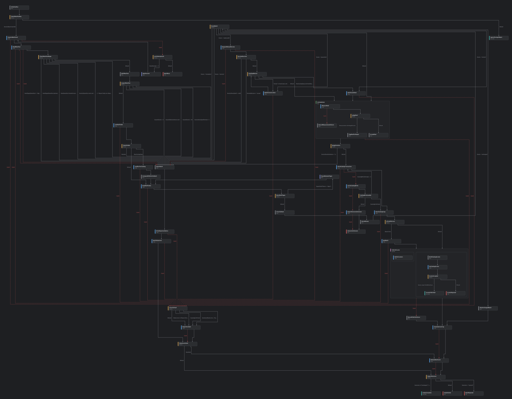
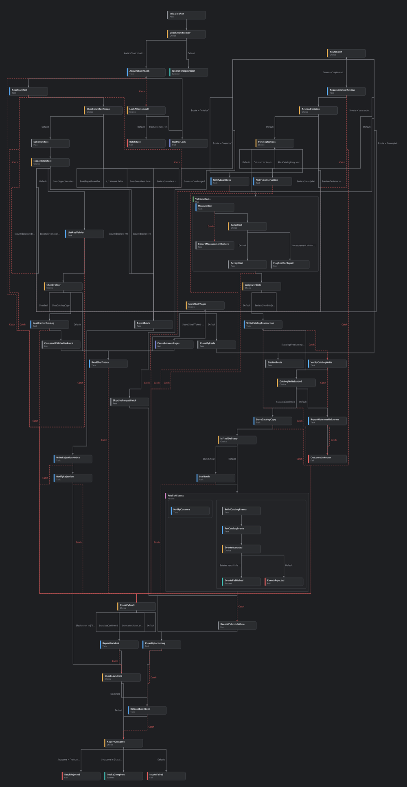

# How to draw the diagram: embedded browser or native

Research and spike, 2026-11-15. Belongs to the design `../specs/2026-11-13-aslan-design.md`, section 6.5 (stage 4).

**Outcome.** The diagram is drawn by the plugin itself, with the IDE's own UI toolkit (Swing) and the Java version of the Eclipse ELK layout library. The embedded browser of the first design is dropped. The commissioner decided this on 2026-11-15, after the spike described below.

## 1. The question

The first design put the diagram into an embedded browser beside the editor, "like the Markdown preview", laid out by the JavaScript library elkjs and drawn as SVG by the plugin's own scripts. While planning stage 4 the commissioner asked whether a JavaScript library is the only way, what is usual in JetBrains IDEs, and whether there is a native alternative.

## 2. What the first design had compared

Only JavaScript libraries, all inside the browser. The browser itself was taken as given.

| Library | Licence | Size | Nested boxes | Right-angle paths |
|---|---|---|---|---|
| elkjs 0.12.1 (layout only) | EPL-2.0 or GPL-3.0-or-later | 1.6 MB | yes | yes |
| dagre 3.1.3 (layout only) | MIT | 49 KB | yes, with a known bug | no |
| Cytoscape.js 3.35.0 | MIT | 443 KB | yes | "taxi" edges |
| React Flow 12.12.1 | MIT | 189 KB plus React | sub-flows, no layout of its own | step edges, no avoidance |
| maxGraph 0.25.1 | Apache-2.0 | depends on use | groups | yes |
| JointJS core 4.3.4 | MPL-2.0 | 474 KB | not checked | not checked |
| Graphviz as WebAssembly 1.30.0 | Apache-2.0 | 820 KB | clusters | `splines=ortho` |

elkjs was chosen because it handles nested boxes and right-angle paths without extra work. No native route was compared; that was a gap.

## 3. What is usual in JetBrains IDEs

- **JetBrains' own diagrams** (UML classes, Maven and Gradle dependencies) use the bundled Diagrams framework (plugin `com.intellij.diagram`), which is Swing on top of the commercial yFiles library. It offers an API to other plugins, but it belongs to the paid features: in 2026.2.3 its modules depend on `com.intellij.modules.ultimate`. A plugin meant for every IDE with YAML support cannot build on it.
- **Previews beside an editor** (Markdown, JetBrains' Mermaid plugin) use the embedded browser (JCEF). This is the usual route for third-party plugins, because HTML and SVG are quick to write.
- **Own drawing in Swing** is how the IDE draws everything else. For a graph it needs a layout library; yFiles is not available to others.

## 4. The two options

**A. Embedded browser.** Kotlin turns the document model into JSON. A page in the embedded browser lays it out with elkjs and draws SVG. Clicks go back to Kotlin as messages.

**B. Native.** Kotlin lays out the model with ELK as a Java library and paints the result in a Swing component. elkjs is that same Java library compiled to JavaScript, so both options use one layout algorithm in one version (0.12.1).

| | A. Embedded browser + elkjs | B. ELK in Java + Swing |
|---|---|---|
| Layout result | the same | the same |
| Languages | Kotlin and JavaScript, with a message contract between them | Kotlin only |
| Automated tests | Kotlin tests, plus JavaScript tests that need Node in the build; what happens in the browser is checked by hand | all in the existing test framework, including what a click at a point selects |
| Drawing and interaction | little code: SVG and CSS give hover, dashes and theming; the mockup carries over almost as it is | more code: painting, click detection, zoom, pan and hover are written by hand |
| Toolbar, details panel, colours | rebuilt in HTML and kept in step with the IDE's theme | the IDE's own components, actions and colours |
| Where it works | needs the embedded browser, which is a separate bundled plugin since 2026.2 and is reported missing in Android Studio's runtime | wherever the IDE runs |
| Memory | a browser process beside the IDE, unless one already runs | none besides the plugin |
| Added size | about 1.6 MB before compression | about 5.5 MB of jars (section 6) |
| Unknowns before the spike | serving the page from inside the plugin; hover texts and focus in the browser | ELK and its Eclipse dependencies inside the IDE; the plugin verifier |
| Later project: editing in the diagram | possible | possible, with the IDE's undo and actions at hand |

**Ruled out:** the Diagrams framework (paid features only); JGraphX (no longer maintained); Graphviz (needs an installed program, or WebAssembly and with it a browser again); writing a layered layout with right-angle routing and nested boxes from scratch (a large job with worse results than ELK).

## 5. The spike

On the local branch `spike/elk-java` (two commits, not pushed, not for merging). It added the dependency `org.eclipse.elk:org.eclipse.elk.alg.layered:0.12.1`, a function that turns the document model into an ELK graph and lays it out, a test on the large synthetic definition (`film-archive-intake.asl.yaml`, 62 states, 112 transitions), a drawing of the result with Java2D into a PNG, and a command-line starter that runs the layout inside a real IDE without a window.

| Question | Result |
|---|---|
| Does the layout work in the JVM? | Yes. 20 to 200 ms for the large definition, depending on the options; the first call adds about 60 ms for start-up. |
| Are the results usable? | Every path runs in right angles; no two states of one machine overlap; Map and Parallel states are boxes around their inner states. |
| Does it run in a real IDE, under the plugin's own class loader? | Yes, in IntelliJ IDEA 2026.2.3 (`./gradlew runIde --args="aslanElkSpike"`). No service lookup is needed: the plugin registers the algorithm itself. |
| Does the plugin verifier accept the jars? | Yes. "Compatible" with 2026.2.3 and 2026.3, no problems listed. The EMF jars refer to Eclipse runtime classes that are not present; the layout never loads them and the verifier does not report them. |
| Can the plugin draw the diagram itself? | Yes. About 90 lines of Java2D drew the pictures below: boxes with the type colour, names, right-angle paths with arrowheads, dashed catch paths, labels. |

The calls that matter, so the knowledge does not depend on the branch:

```kotlin
LayoutMetaDataService.getInstance().registerLayoutMetaDataProviders(LayeredMetaDataProvider())   // once
val root = ElkGraphUtil.createGraph()
root.setProperty(CoreOptions.ALGORITHM, LayeredOptions.ALGORITHM_ID)
root.setProperty(CoreOptions.DIRECTION, Direction.DOWN)
root.setProperty(CoreOptions.EDGE_ROUTING, EdgeRouting.ORTHOGONAL)
root.setProperty(CoreOptions.EDGE_LABELS_INLINE, true)
val node = ElkGraphUtil.createNode(root).apply { setDimensions(190.0, 40.0) }   // a box: createNode(node) for its children
val edge = ElkGraphUtil.createSimpleEdge(from, to)                              // lands in the node that holds both ends
ElkGraphUtil.createLabel("Default", edge).setDimensions(width, 14.0)
RecursiveGraphLayoutEngine().layout(root, BasicProgressMonitor())
// then: node.x, node.y relative to the parent; edge.sections.single() with start, bend points and end,
// relative to edge.containingNode; label.x, label.y
```

**Not covered by the spike:** the interactive part (click detection, zoom, pan, hover) and the details panel as Swing components; behaviour in remote development, which stays a non-goal.

## 6. Size, and Guava

ELK needs the Eclipse EMF libraries and Guava (15 or newer).

| Build | Plugin zip |
|---|---|
| Before the spike | 0.76 MB |
| With ELK, EMF and a bundled Guava 33.8 | 8.4 MB |
| With ELK and EMF, Guava taken from the IDE | 6.0 MB |

The jars: `elk.core` 2.1 MB, `elk.alg.layered` 1.3 MB, `elk.alg.common` 0.2 MB, `elk.graph` 0.1 MB, `emf.ecore` 1.2 MB, `emf.common` 0.4 MB, `emf.ecore.xmi` 0.2 MB; Guava 3.1 MB.

**Guava from the IDE works.** The IDE ships Guava as the module `intellij.libraries.guava`: version 33.5.0 in 2026.2.3 and 33.7.1 in 2026.3. With Guava excluded from the plugin, the layout ran in the real IDE, the test passed, and the verifier reported both versions compatible. JetBrains documents that classes a plugin does not carry itself are loaded by the IDE's main class loader, and that a plugin may carry its own copy of a library to take precedence. So the IDE's copy is the lighter choice, and its version is JetBrains' to change. ELK accepts any version from 15 on, which leaves a wide margin. Should a later IDE drop Guava, the plugin bundles its own copy by removing one exclusion in the build.

**Licences.** ELK 0.12.1: EPL-2.0. EMF 2.12.0: EPL-1.0. Both are bundled unmodified with their notices; the plugin's own code stays Apache-2.0.

## 7. What the pictures showed about the layout

These findings hold for either option, since the algorithm is the same.

| Variant (large synthetic definition) | Paths | Width × height |
|---|---|---|
| Default options, labels up to 30 characters | all 112 | 4,978 × 3,878 |
| The same, catch paths left out of the layout | 86 | 4,207 × 3,034 |
| Compact node placement, file order kept | all | 3,164 × 3,876 |
| The same, catch paths left out | 86 | 2,897 × 3,038 |
| Compact placement, paths into one state share a line, labels up to 20 characters | all | 1,967 × 3,842 |
| The same, catch paths left out | 86 | 1,984 × 2,982 |

Loose (default options), scaled down:



Compact (shared lines, shorter labels), scaled down:



1. **A large machine never fits a pane.** Fitted into a pane 600 pixels wide, the loose layout shrinks a state to about 20 pixels. The diagram has to open at full size around the selected state, with fit-to-window as a button.
2. **Loose and compact both have their place.** The compact layout is about 60% narrower and reads as a flow chart, but it is crowded, and where paths share a line a single path is harder to follow by eye. For a small machine the loose layout looks better. The commissioner decided to offer both through a switch.
3. **Catch paths must stay in the layout.** With catch paths left out before the layout, states that are reached only through a Catcher lost their place in the flow and drifted to the top. The commissioner decided that "hidden" only stops them from being drawn; the layout is the same in all three settings of the switch.
4. **Labels cost width.** Each label on a path takes room in its layer. Cutting labels at 20 instead of 30 characters is part of what makes the compact layout narrow.
5. **Selecting a path matters more in the compact layout**, because it is the way to follow one path among shared lines.

## 8. Decisions

By the commissioner, 2026-11-15:

- Option B, native.
- A switch between the loose and the compact layout.
- The catch switch hides catch paths without taking them out of the layout.

The design document carries these in sections 5 and 6.5.

## Sources

- Jars and descriptors of IntelliJ IDEA 2026.2.3 (IU-262.10968.63) and 2026.3 (IU-263.7307.200), read on 2026-11-15: the Diagrams plugin, the embedded browser plugin, `intellij.libraries.guava`.
- Maven Central, `org.eclipse.elk` 0.12.1 and its POM files; npm registry, `elkjs` 0.12.1.
- JetBrains, IntelliJ Platform Plugin SDK, "Plugin Class Loaders": https://plugins.jetbrains.com/docs/intellij/plugin-class-loaders.html
- JetBrains, "Embedded Browser (JCEF)": https://plugins.jetbrains.com/docs/intellij/embedded-browser-jcef.html
- Eclipse Layout Kernel, the layered algorithm: https://eclipse.dev/elk/reference/algorithms/org-eclipse-elk-layered.html
